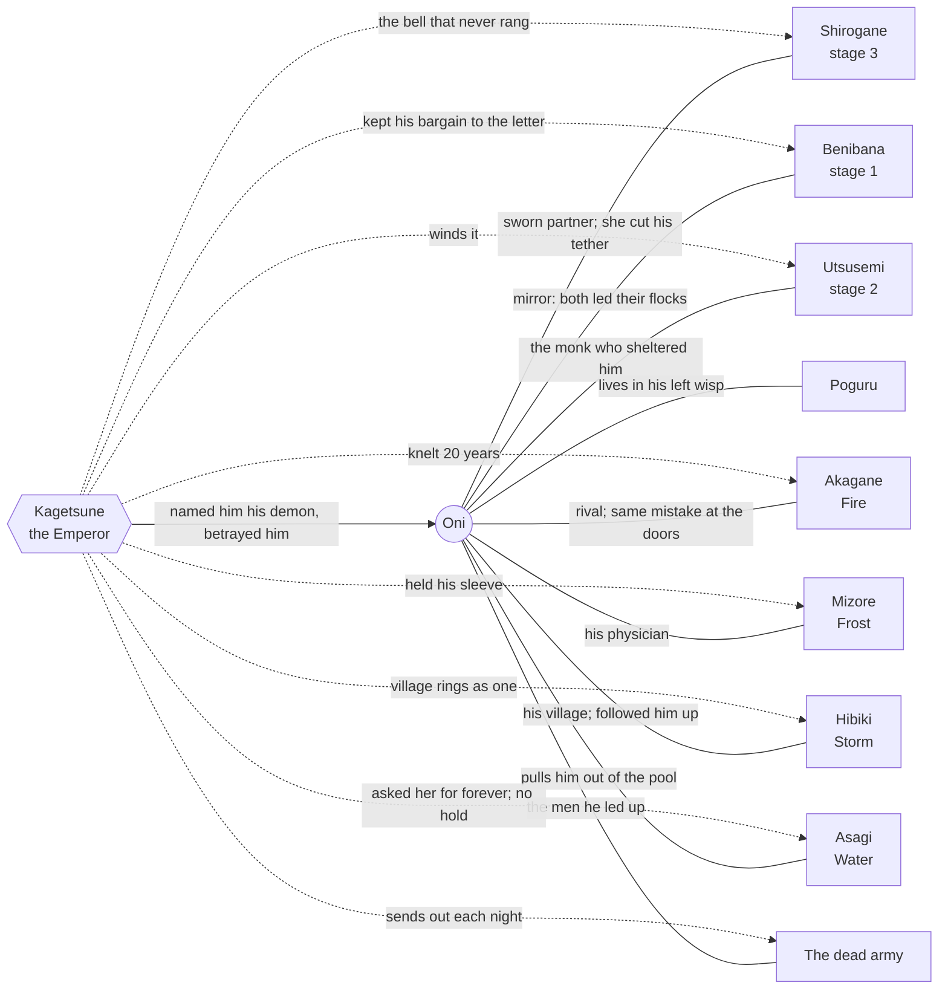
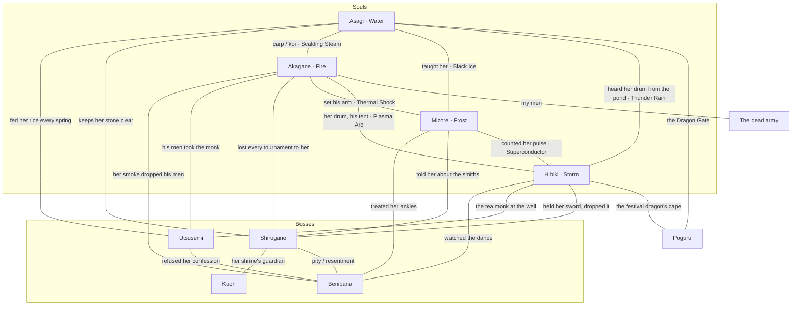

# The relationship map

[Back to the story](README.md)

Every bond in the cast on one page: who knows whom, what they call each other, what they share from the Night of a
Thousand Bells, and which conversations already carry each bond. Use it before writing a line (does this pair
already talk? what do they call each other?), to find where a new line belongs (the gaps below), and to see where a
new character could fit. The character files are the source; if this page and a character's file disagree, the file
wins, and fix both. Update this page when a relationship changes or a crossover line is added.

Ids are conversation ids in `Assets/Scripts/Dialogue/Dialogue.Lines.cs` (voice clips `Audio/Voice/<id>.mp3`).
"Written, not in game" means the line is in a character file but not in `Dialogue.Lines.cs`.

## The web

**Oni at the centre, and Kagetsune's hold.** Solid lines are Oni's bonds; dotted lines are Kagetsune's hold on
each soul.

**The cast among themselves** (Oni and Kagetsune left out).

Every character but Poguru and Asagi is Kagetsune's victim, and none of them serves him willingly any more. Kuon is
bound to Shirogane by him but obeys only her. Asagi was never on the mountain and has no bell; she is the only
soul he never held.

## Who was on the mountain

Oni led three groups up to the "coronation". Every soul character comes from one of them, which is what ties them
to him and to each other.

| Group | Who | Their bell |
|---|---|---|
| **The court** | Mizore, Benibana (and her hidden congregation), the courtiers | Bells of rank. Mizore's is the small cracked one closest to his heart, the first he hung. |
| **The army** | Akagane, his vanguard (now the dead army), the Bellringers (his shrine watch) | Bells of rank. Akagane's is the war bell on his right shoulder, the one the Bellringers answer. |
| **The village** | Hibiki, her mother ("Ma"), the villagers, Oni's own people | No bells of their own: the whole village rings as one sound inside the coffin. |
| Outside the three | Shirogane (a guard, like Oni), the monk (taken later, on the Pilgrim's Pass), Kuon (bound later, at the Frozen Shrine), Asagi (never went: she was on her hill, and heard the bells stop from there) | Shirogane's never rang. Asagi has none. |

## What they call each other

The fastest check before writing a line. Blank means they never address each other in game.

| Speaker → | Oni | Kagetsune | Shirogane | Akagane | Mizore | Hibiki | Asagi | Poguru |
|---|---|---|---|---|---|---|---|---|
| **Oni** | | (never by name in lines) | "Shirogane" | | "she" | "Hibiki" (once he remembers) | "Mizore" (to her, of her student) | |
| **Kagetsune** | **"little demon"** (his alone), "Oni" | | "Shirogane" | "my captain" | "Mizore" | "the village drum" | "the fish on the hill" | |
| **Benibana** | "Oni", "shepherd", "demon" | "Kagetsune" | | | "the physician" | "the drummer girl" | "the pond" | |
| **Utsusemi** | **"boy"** (its alone), "Oni", "clever boy" | | | | | "a drummer" | "the fish" (the monk, surfacing) | |
| **Shirogane** | "Oni" | | | "Akagane", "copper" | "Mizore" | "the drummer girl" | "the old koi" | |
| **Akagane** | **"Guardsman"** (his alone) | "him" | "silver", "she" | | **"physician"** | **"girl"** | **"carp"** | "that" |
| **Mizore** | **"Oni"**, "young man" | "my prince" (the boy), "he" | "she" | **"Captain"** | | **"Hibiki"** | **"Teacher"** | "creature", "your little dragon" |
| **Hibiki** | "Oni", **"my lord guardsman"** | "he" | **"Lady Shirogane"** | **"Captain Kettle"** | **"Grandmother"** | | **"Great-Grandmother"** | "the festival dragon" |
| **Asagi** | **"little fry"**, **"flute boy"**, "Oni" (only after `Asagi_Meet_Home`) | "the boy who wanted forever", "he" | "the one who listened", "she" | **"little kettle"** | **"little sleet"**, "my student" | "the drummer girl", "dear" | | "very small dragon", "dear" |
| **Poguru** | "Oni" | (hides) | "the silver lady", "she" | "the grumpy captain" | "the bird granny" | "the drummer girl" | "the fish lady" | |

- Mizore always answers "Grandmother" with "I'm not your grandmother." Asagi answers "Great-Grandmother" with
  "Yes, dear." and "carp" with "Koi."
- Utsusemi: the machine is **"it"**, the monk inside is **"he"**. The voice softens when he surfaces.
- Kuon never speaks (growls and howls only). Only Shirogane addresses it: "Kuon".
- The army calls Oni "the Emperor's runaway dog", "traitor", "the coffin's demon".

## The bonds, pair by pair

Each entry: the bond, from each side where they differ; the shared fact; the conversations that already carry it.

### Oni and everyone

| Pair | The bond | Carried by |
|---|---|---|
| Oni – Kagetsune | His lord, his betrayer, the man who named him. Kagetsune speaks to him as a master to a dog; to him Oni is the one soul that got away. | Every Kagetsune intro/phase/defeat/KilledOni, Oni's answers, `Oni_Hub_Ringing` |
| Oni – Shirogane | Sworn partners, the two blades. She cut his tether and was sealed in his place; she wears his oni mask so he wouldn't carry the name alone. He forgets her a little each run; she remembers everything. | Her intros, `Shirogane_Intro_Oath`, Oni's answers, `Shirogane_Freed`, `Shirogane_Farewell`, `Oni_Hub_Together` |
| Oni – Benibana | Mirrors: both led their own people to the altar. She envies that he got out; later he's the one who understands her. | `Benibana_Intro*`, `Benibana_Intro_Bell`, Oni's answers, `Oni_Hub_Smoke` |
| Oni – Utsusemi | The monk sheltered him the first night and was taken for it. It hunts the boy he saved; Oni doesn't know the hat until the gears slip. | `Utsusemi_Intro*`, `Utsusemi_Intro_WindDown`, `Oni_Hub_Hat` |
| Oni – Kuon | None of its own. It guards her; he is the one cutting at her. | (fight only) |
| Oni – Poguru | His person. Oni answers in two words and secretly needs him; Poguru remembers for him (mostly wrong things). | All `Poguru_*`, especially `Poguru_Talk_*` and the roasts |
| Oni – Akagane | Rivals for the Emperor's favour; Akagane got the vanguard, Oni the place beside Shirogane. Both guarded the wrong side of the door. Contempt, then grudging alliance, then a promised salute. | `Akagane_Meet_*` (Angry → Copper → Men → Doors → Bellringers → Salute), `Akagane_Hub_Salute` |
| Oni – Mizore | Her patient. She set his collarbone at sixteen; she watches the coffin take his memories and minds. Dry, never cruel. | `Mizore_Meet_*` (Steady → Collarbone → Smoke → Prince → Smiths → Oath), `Mizore_Hub_Sleep` |
| Oni – Hibiki | From his village; she adored him and drummed him out the morning he left. He forgets her name; she admits she blames him and would follow him anyway. He wins back the river memory on his own. Never romantic. | `Hibiki_Meet_*` (Out → Name → Procession → OneBell → Blame → River), `Hibiki_Hub_RiverSong` |
| Oni – Asagi | The koi of the pond he wakes in; she pulls him out every time and has from the first death. Warm, nosy, fussing; she knew his face from the hill years before and doesn't say so until her fifth chapter. He is her last patient, and she's sending him home. | `Asagi_Meet_Pool` (the temple), `Asagi_Meet_*` (Fry → Sleet → Prince → Monk → Flute → Home), `Asagi_Pond_*` (her station), `Asagi_Hub_Sleep` |
| Oni – the army | His own men and the court guard, walking in the bodies they died in. Every one he cuts down goes back to the coffin. | `Tut_*`, Akagane's lines about "my men" |

### Boss and boss

| Pair | The bond | Carried by |
|---|---|---|
| Benibana – Kagetsune | He kept his bargain to the letter (her people "never die"), then sealed her last. Her hatred is colder than anything she says to Oni. | `Benibana_Echo` ("Your strings again..."), `Kagetsune_SummonBenibana` |
| Utsusemi – Kagetsune | Its winder. His bell answers its phase break. | `Utsusemi_Echo`, `Kagetsune_SummonUtsusemi`, the phase-break toll |
| Shirogane – Kagetsune | The lord she refused to kneel to. Her bell is the only thing that unsettles him. | `Shirogane_Echo`, `Kagetsune_SummonShirogane`, `Kagetsune` intro "She never rang." |
| Kuon – Kagetsune | He bound it to her to make her harder to beat, and gave her a friend. It obeys her, never him. | (fight only) |
| Shirogane – Kuon | The shrine's guardian, who chose her as a girl feeding it rice cakes at the gate. One oath, one bar between them. | Barks: "...Rest, Kuon.", `Shirogane_KuonEnraged` ("Kuon... don't hold back.") |
| Shirogane – Benibana | Shirogane pities her (she understands bargains made for others); Benibana resents and admires the one who refused. | Shirogane's intro after `Benibana_Intro_Bell` ("She told you which bell is hers."), `Benibana_Intro_Silver` ("Don't tell her I called her brave.") |
| Utsusemi – Benibana | The monk once refused her confession. The machine doesn't remember why. | `Utsusemi_Intro_Confession` ("Why did I... send her away?") |
| Benibana / Utsusemi – Shirogane, Utsusemi – Shirogane | No stated bond. | — |

### Soul and boss

| Pair | The bond | Carried by |
|---|---|---|
| Akagane – Benibana | Her smoke put his vanguard on its knees. He curses her by name until she names her bell, then stops, mostly. | `Akagane_Ahead_Benibana`, `Akagane_Ahead_BenibanaBell`, `Akagane_Felled_Benibana`, `Akagane_Pickup_DiedBenibana`, `Akagane_Pickup_ManyDeaths`, and her answer, `Benibana_Intro_Captain` (his men at the doors, facing out). |
| Akagane – Utsusemi | His men, in borrowed bodies, took the monk. He remembers marching, not choosing; it shames him. | `Akagane_Ahead_Utsusemi`, `Akagane_Felled_Utsusemi`, `Utsusemi_Intro_Fire` (the torches) |
| Akagane – Shirogane | She beat him at every tournament and was kind about it. He respects her above anyone, and won't say so. | `Akagane_Ahead_Shirogane`, `Akagane_Felled_Shirogane`, `Akagane_Pickup_DiedShirogane`, `Shirogane_Intro_Fire` |
| Akagane – Kagetsune | Twenty years on his knees. The only anger he never jokes about. | `Akagane_Ahead_Kagetsune`, `Akagane_Pickup_DiedKagetsune`, `Akagane_Pickup_Seal`, `Kagetsune_Intro_Fire`, `Kagetsune_Intro_Souls` |
| Mizore – Benibana | Treated her ankles, saw the rosary, said nothing, and is glad. Blames the man who asked for the smoke, not her. | `Mizore_Ahead_Benibana`, `Mizore_Felled_Benibana`, `Mizore_Meet_Smoke`, `Benibana_Intro_Frost` |
| Mizore – Utsusemi | A professional horror: she'd like to see how a soul was wound into gears, so she could undo it. | `Mizore_Ahead_Utsusemi`, `Mizore_Felled_Utsusemi`, `Utsusemi_Intro_Frost` (indirect) |
| Mizore – Shirogane | She told Shirogane about the dying smiths, which began the oath, and has never decided whether that was right. She stitched Shirogane's left side often. | `Mizore_Meet_Smiths`, `Mizore_Meet_Oath`, `Mizore_Ahead_Shirogane`, `Mizore_Felled_Shirogane`, `Shirogane_Intro_Frost` |
| Mizore – Kagetsune | Held his hand (he held her sleeve) as his father died; "Everyone dies, my prince. Even emperors." She thinks that sentence was the armor's first piece. The only one who pities him; pity isn't forgiveness. | `Mizore_Meet_Prince`, `Mizore_Ahead_Kagetsune`, `Mizore_Ahead_KagetsuneWon`, `Mizore_Pickup_FirstClear`, `Kagetsune_Intro_Frost`, `Kagetsune_Intro_Souls` |
| Hibiki – Benibana | The most beautiful thing she ever saw, then everyone got sleepy. Still working out how to feel. | `Hibiki_Ahead_Benibana`, `Hibiki_Felled_Benibana`, `Benibana_Intro_Storm` |
| Hibiki – Utsusemi | The tea monk who stopped at the village well each spring and let the children wear his hat. She's sure he's still in there. | `Hibiki_Ahead_Utsusemi`, `Hibiki_Ahead_UtsusemiTea`, `Hibiki_Felled_Utsusemi`, `Hibiki_Pickup_DiedUtsusemi`, `Utsusemi_Intro_Storm` |
| Hibiki – Shirogane | "Lady Shirogane" visited with Oni and let her hold her sword; she dropped it. Worship and terror in equal parts. Shirogane laughed. | `Hibiki_Ahead_Shirogane`, `Hibiki_Felled_Shirogane`, `Hibiki_Pickup_DiedShirogane`, `Shirogane_Intro_Storm`, and the message delivered, `Hibiki_Laughed` |
| Hibiki – Kagetsune | Saw him once from the procession; he didn't look at any of them. Her drum against his bells. | `Hibiki_Meet_OneBell`, `Hibiki_Ahead_Kagetsune`, `Hibiki_Pickup_DiedKagetsune`, `Kagetsune_Intro_Storm`, `Kagetsune_Intro_Souls` |
| Asagi – Benibana | The dancer came up the hill for her ankles once; that night her smoke settled on the pond. Asagi treated the ankles and pities the girl. | `Asagi_Ahead_Benibana`, `Asagi_Felled_Benibana`, `Asagi_Pickup_DiedBenibana`, `Benibana_Intro_Water` |
| Asagi – Utsusemi | The monk fed her rice every spring and talked to the fish, not the body. She wants his clock stopped, gently. | `Asagi_Meet_Monk`, `Asagi_Ahead_Utsusemi`, `Asagi_Felled_Utsusemi`, `Asagi_Pickup_DiedUtsusemi`, `Utsusemi_Intro_Water` |
| Asagi – Shirogane | One of the two guards who sat by her pond: the one who listened. Asagi keeps her flat stone clear and never says who for. | `Asagi_Meet_Flute`, `Asagi_Ahead_Shirogane`, `Asagi_Felled_Shirogane`, `Asagi_Pickup_DiedShirogane`, `Asagi_Pond_Stone`, `Shirogane_Intro_Water` |
| Asagi – Kagetsune | He climbed her hill young to ask how forever was done; she told him it wasn't worth having. She counts his armor as partly hers. He remembers the fish that told him no. | `Asagi_Meet_Prince`, `Asagi_Ahead_Kagetsune`, `Asagi_Ahead_KagetsuneWon`, `Asagi_Pickup_DiedKagetsune`, `Kagetsune_Intro_Water` |
| Asagi – Kuon | A fellow guardian spirit: a shrine's, and a pond's. | (written in Asagi.md, not in game) |
| Any other soul – Kuon | No stated bond. | — |

### Soul and soul

| Pair | The bond | Carried by |
|---|---|---|
| Akagane – Mizore | She set his arm; he called her a butcher. Old palace staff who bicker like a married couple; respect neither admits. | Duo **Thermal Shock** (`Duo_ThermalShock_First`, `_Arm`, `_Again`), `Akagane_Jealous_Mizore`, `Mizore_Jealous_Akagane`, `Akagane_Cut_Mizore`, `Akagane_Pickup_HoldsFrost`, `Mizore_Pickup_HoldsFire` |
| Akagane – Hibiki | His men marched up the mountain to her drum, and he hasn't forgiven the drum; her fireworks burned his supply tent. Gruff and quietly protective; she runs to him first when scared. | Duo **Plasma Arc** (`Duo_PlasmaArc_First`, `_Pace`, `_Again`), `Akagane_Jealous_Hibiki`, `Hibiki_Jealous_Akagane`, `Hibiki_Cut_Akagane`, `Akagane_Pickup_HoldsStorm`, `Hibiki_Pickup_HoldsFire` |
| Mizore – Hibiki | The old woman who held the girl's wrist and counted her pulse to the end. The gentlest pair; only Hibiki could make Mizore laugh. | Duo **Superconductor** (`Duo_Superconductor_First`, `_Count`, `_Again`), `Mizore_Jealous_Hibiki`, `Hibiki_Jealous_Mizore`, `Mizore_Cut_Hibiki`, `Mizore_Pickup_HoldsStorm`, `Hibiki_Pickup_HoldsFrost` |
| Asagi – Mizore | Teacher and student: the girl climbed the hill at twelve and was taught for six years, then went to the palace and never came back up. Warm against cold, the same medicine two ways. | Duo **Black Ice** (`Duo_BlackIce_First`, `_Hill`, `_Again`), `Asagi_Meet_Sleet`, `Asagi_Jealous_Mizore`, `Mizore_Jealous_Asagi`, `Asagi_Cut_Mizore`, `Asagi_Pickup_HoldsFrost`, `Mizore_Pickup_HoldsWater` |
| Asagi – Akagane | "Carp." "Koi." He wants her out of his fire; she wets the enemy first. She calls him "little kettle" and he hates it. | Duo **Scalding Steam** (`Duo_ScaldingSteam_First`, `_Kettle`, `_Again`), `Asagi_Jealous_Akagane`, `Akagane_Jealous_Asagi`, `Asagi_Pickup_HoldsFire`, `Akagane_Pickup_HoldsWater` |
| Asagi – Hibiki | Asagi heard the girl's festival drum from her pond every summer. Hibiki adores her on sight and gets the "Great-Grandmother" Mizore refused her. | Duo **Thunder Rain** (`Duo_ThunderRain_First`, `_Festival`, `_Again`), `Asagi_Jealous_Hibiki`, `Hibiki_Jealous_Asagi`, `Asagi_Cut_Hibiki`, `Asagi_Pickup_HoldsStorm`, `Hibiki_Pickup_HoldsWater` |

Jealousy, at a glance: Akagane is jealous of Hibiki most (a village girl's speed over the vanguard's fire), Mizore
mildly, and dismisses Asagi ("stay in your pond, carp"). Mizore is dry about Fire ("fevers are popular, briefly"),
worried about Storm, and stiff about her teacher. Hibiki sulks at Fire and Frost and adores Water. Asagi is fond
of all three and gives the boon anyway.

### Poguru and everyone

| Pair | The bond | Carried by |
|---|---|---|
| Poguru – Shirogane | The wisps go warm near her; he doesn't know why and Oni won't say. In the true ending the other wisp is hers, and he's delighted to have a neighbour. | `Poguru_Talk_Silver`, `Poguru_Ahead_Shirogane`, `Poguru_Boss_Shirogane`, `Poguru_Wake_Shirogane`, roasts |
| Poguru – Kagetsune | He hides in the wisp, and isn't proud of it. | `Poguru_Ahead_Kagetsune`, `Poguru_Wake_Kagetsune`, roasts |
| Poguru – Benibana / Utsusemi | Comic only: "Smoke lady", the ticking. Warns Oni in Utsusemi's fight. | `Poguru_Ahead_*`, `Poguru_Boss_*`, `Poguru_Wake_*`, `Poguru_Utsu_*`, roasts |
| Poguru – Kuon | "It doesn't have thumbs!" | `Poguru_Roast_ShiroganeWolf` |
| Poguru – Akagane | "The vanguard had a dog once. It was braver." | `Akagane_Poguru`, `Poguru_Soul_Fire` |
| Poguru – Mizore | Diagnosed as running warm. "Do souls get fevers?" | `Mizore_Poguru`, `Poguru_Soul_Frost` |
| Poguru – Hibiki | His cape is the village's paper festival dragon, which she paraded round the well every summer: why it smells like lanterns. | `Hibiki_Poguru`, `Poguru_Talk_Cape`, `Poguru_Soul_Storm` |
| Poguru – Asagi | "A FISH, and it's a LADY." The Dragon Gate: koi that climb the falls become dragons. He's in awe; she liked her pond. | `Asagi_Poguru`, `Poguru_Soul_Water` |
| Poguru – the army | He bonks their arrows; he says hi to them. | `Poguru_Tut_*`, `Poguru_Round_Wave` |

## Coverage: which pairs talk

How much the row's speaker says to or about the column's character, from the "Carried by" lists above:
**●** three or more conversations, **◐** one or two, **○** none. Oni talks with everyone (his answers, the souls'
chains, Poguru's talks), so he has no row. Read across a row to see who a character is missing.

| Speaker ↓ / about → | Benibana | Utsusemi | Shirogane | Kuon | Kagetsune | Akagane | Mizore | Hibiki | Asagi | Poguru |
|---|---|---|---|---|---|---|---|---|---|---|
| **Benibana** | | ○ | ◐ | ○ | ◐ | ◐ | ◐ | ◐ | ◐ | ○ |
| **Utsusemi** | ◐ | | ○ | ○ | ○ | ◐ | ◐ | ◐ | ◐ | ○ |
| **Shirogane** | ◐ | ○ | | ◐ | ◐ | ◐ | ◐ | ◐ | ◐ | ○ |
| **Kagetsune** | ◐ | ◐ | ◐ | ○ | | ◐ | ◐ | ◐ | ◐ | ○ |
| **Akagane** | ● | ◐ | ● | ○ | ● | | ● | ● | ● | ◐ |
| **Mizore** | ● | ● | ● | ○ | ● | ● | | ● | ● | ◐ |
| **Hibiki** | ● | ● | ● | ○ | ● | ● | ● | | ● | ◐ |
| **Asagi** | ● | ● | ● | ○ | ● | ● | ● | ● | | ◐ |
| **Poguru** | ● | ● | ● | ◐ | ● | ◐ | ◐ | ◐ | ◐ | |

The pattern: the souls talk about everyone, the bosses barely talk about each other (Benibana on Shirogane and Utsusemi on Benibana are the first), and nobody but Shirogane and
Poguru mentions Kuon (Asagi's Kuon line is written but not in game).

## Where lines are missing

Bonds the files set up that no line in game pays off yet. These are the best places for new voice lines.

Carried since: Utsusemi – Benibana (`Utsusemi_Intro_Confession`), Benibana – Akagane (`Benibana_Intro_Captain`),
Benibana – Shirogane (`Benibana_Intro_Silver`), "Tell her I laughed" (`Hibiki_Laughed`) and Kagetsune on the three
souls (`Kagetsune_Intro_Souls`). The firsts record (`Got(...)`: items, relics, souls, bosses met) is a new way to gate
lines like these.

1. **Kuon.** Nobody but Shirogane and one roast acknowledges it. Mizore (a shrine's cold, a guardian), Hibiki (a
   wolf!) or Akagane (the vanguard's dog) could each react on `BossAhead` / `BossFelled` for Shirogane.
2. **Shirogane – Poguru.** The wisps go warm near her, but she never notices him. A Shirogane intro or defeat beat
   could, gently.
3. **The freed beats.** `Akagane_Freed` ("Vanguard. Stand down..."), `Mizore_Freed` ("There, my prince..."),
   `Hibiki_Freed` ("We're out!...") and Akagane's salute are written in their files but not in game or voiced.
4. **Suggested in [Souls.md](Souls.md#suggested-lines-for-other-files), not in game:** Kagetsune's `KilledOni` with
   `holds Fire ≥ 3`, and Oni's `HubReturn` "Hibiki. ...Hibiki. Hibiki." after `Hibiki_Meet_Name`.
5. **Oni about the souls.** Oni has no `HubReturn` line about any of the three after their chains finish
   (Doors, Prince, Blame are the heaviest beats of his guilt arc).
6. **Kagetsune about Kuon** (the gift that backfired) and **about Poguru** (a sliver of his own armor's fire that
   got away with Oni) are open, if he should ever acknowledge either.

## Arc gates: which line unlocks which

Some lines can only be written once another has played. New lines that touch these beats should gate on the same
ids.

| Once this plays | It unlocks |
|---|---|
| `Benibana_Intro_Bell` (she names her bell) | Her soul counts as freed after one more win; Shirogane's "She told you which bell is hers" intro; `Akagane_Ahead_BenibanaBell` (he stops cursing her) |
| `Utsusemi_Intro_WindDown` ("Boy. Wind me down.") | The monk freed after one more win; `Hibiki_Ahead_UtsusemiTea` |
| `Shirogane_Intro_Oath` | Shirogane freed after one more win; `Oni_Hub_Together`; Kagetsune's "She never rang." intro; `Mizore_Meet_Oath`; `Asagi_Meet_Home`; `Asagi_Pond_Stone` |
| `Asagi_Meet_Pool` (the temple, on the wake after run 2) | Water souls on the paths (`Save.Data.asagiMet`); her chain; `Asagi_Pond_Hello` |
| `Asagi_Meet_Flute` (she admits she knew their faces) | `Asagi_Pond_Flute` |
| `Asagi_Meet_Home` (needs Shirogane's oath, like Mizore's last chapter) | (written) `Asagi_Dawn` |
| `Akagane_Meet_Salute` | `Akagane_Hub_Salute`; (written) `Akagane_Freed` and the salute |
| `Mizore_Meet_Oath` (needs Shirogane's oath, so she finishes last) | (written) `Mizore_Freed` |
| `Hibiki_Meet_Name` | `Hibiki_Poguru`; (suggested) Oni's "Hibiki. ...Hibiki." |
| `Hibiki_Meet_River` (Oni's own remembered memory) | `Hibiki_Hub_RiverSong`; (written) `Hibiki_Freed` |
| `Akagane_Meet_Copper` / `Mizore_Meet_Collarbone` | Their Poguru crossovers |
| A first clear | `*_Pickup_FirstClear`, `Akagane_Meet_Salute`, `Hibiki_Meet_River` |

## Room for new characters

The story already leaves these people offstage. A new character fits best in one of these slots, because the
existing cast already has a reason to know them.

| Slot | Already mentioned in | Who would know them |
|---|---|---|
| Hibiki's mother, "Ma", and the villagers | `Hibiki_Meet_Procession` | Hibiki, Oni, Poguru (the festival dragon) |
| Oni's village (still unnamed; see Souls.md open questions) | Oni.md, Hibiki.md | Hibiki, Oni, Utsusemi (the well) |
| The six smiths who forged the armor | `Mizore_Meet_Smiths` | Mizore, Shirogane, Kagetsune |
| Benibana's congregation, and the inquisitors who took them | Benibana.md | Benibana, Mizore (the rosary), Kagetsune |
| The old Emperor, Kagetsune's father | `Mizore_Meet_Prince` | Mizore, Kagetsune |
| Akagane's men by name, and the vanguard's dog | Akagane.md, `Akagane_Poguru` | Akagane, Oni, the army |
| The Bellringers, Akagane's shrine watch | `Akagane_Meet_Bellringers` | Akagane |
| Shirogane's family and their shrine | Shirogane.md, Kuon.md | Shirogane, Kuon |
| The monk before he was taken (his forty years of roads) | Utsusemi.md | Utsusemi, Oni, Hibiki |

**Rules any new character must keep:**

- If they died on the Night, they are a sealed soul with a bell (or ring inside the coffin, if from the village),
  and they are Kagetsune's victim. None serves him willingly.
- Teal is soul-fire only. A bound soul shows its own colour until it is freed.
- Bells mean sealed souls; a bell going silent means a soul set free.
- Keep the address rules: "little demon" is Kagetsune's, "boy" Utsusemi's, "Guardsman" Akagane's,
  "my lord guardsman" Hibiki's.
- Oni stays brief. Poguru stays the only one who jokes at length (Hibiki the only soul who jokes).
- No sexualised framing for anyone, and nothing romantic between Oni and Hibiki.
- Give them a place among the three groups (court, army, village) or a reason they were outside them. Asagi is
  the one precedent for "outside": she never left her hill, so she has no bell and Kagetsune no hold on her, and
  she joins the souls only once Oni has met her in the temple.
